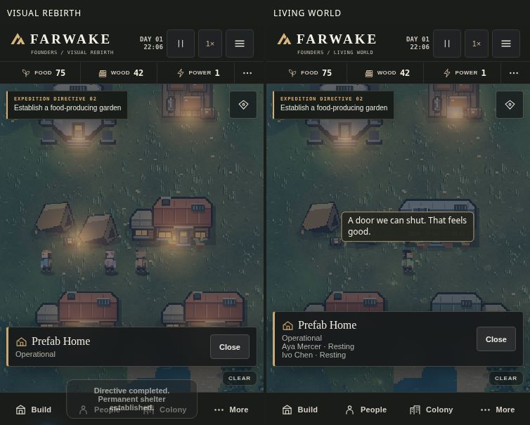

# Living World release candidate

This comparison uses a staged three-home settlement at night and advances the actual simulation. In Living World, the selected home lists the people resting inside.

- Walking presents a damped position, directional stride, posture and footsteps derived from distance travelled. The existing simulation still chooses jobs, calculates paths and moves the people.
- Indoor jobs route via the opening drawn on that building. Doors respond to nearby users, stay open for groups and close after passage. When access is obstructed, jobs can use the existing reachable perimeter. The inspector lists actual occupants and activities. Four prefab home variants share the original buildable footprint and cost.
- Work progress drives tool swings and impacts. A felled tree leaves physical timber. Pickup, delivery and construction completion trigger distinct feedback.
- Nearby founders can exchange brief lines. Needs, work, weather, personal traits and completed directives inform their dialogue. Recent thoughts and conversations appear in the colonist profile.
- Vegetation, water, insects, drifting leaves, dawn mist, rainfall and occasional storm cells respond to terrain and conditions. Occupied windows and equipment indicators show activity after sunset.
- Original synthesized sound includes environmental beds, short tool and material sounds, door mechanisms and occasional plucked musical phrases. Tap the game to enable audio. More → World settings contains four volume controls, mute, dialogue density and three graphics presets. Device preferences persist independently of expedition saves.
- Includes the playtest branch's reachable exploration targets, starter ore, outdoor material reserves and portable save backups. Version 3 expeditions retain the same storage key. Ongoing indoor jobs resume from saved state. Outdoor workers keep their positions and cargo and choose their route again after loading.

## Playable verification

The Chromium browser ran the game at 375×667, 390×844, 430×932 and 844×390. Checks covered touch placement, completed construction, actual gathering and hauling, research, movement, shared camp entry and exit, occupied save/load, workshop alloy production, dialogue and carrying a load across a reload. A user gesture started the Web Audio context and mute persisted. All three presets rendered dawn, day, sunset and night across clear, windy and rainy conditions. Gait integration was compared at 30, 60 and 120 updates per second at multiple simulation speeds.

A short desktop Chromium probe measured median simulation tick plus Canvas draw submission at 0.50 ms (5 colonists), 0.70 ms (20) and 1.10 ms (40). Each used twelve warm samples. These measurements exclude full frame presentation and do not predict sustained iPhone frame rate.

Run `python tests/prepare-visual-check.py` and serve the printed directory on a fresh local origin. Open `/check.html` to run the regression checks.

## Limits

Physical Safari audio routing, speaker balance, battery use and sustained FPS need an iPhone playtest. Homes vary in silhouette and furnishings within their established collision footprints. There are no explorable interiors, building upgrade tiers or relationship simulation in this release.
