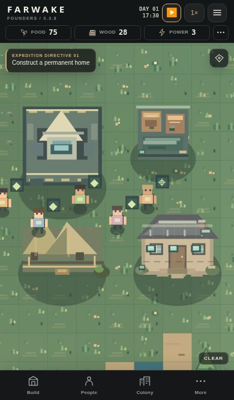
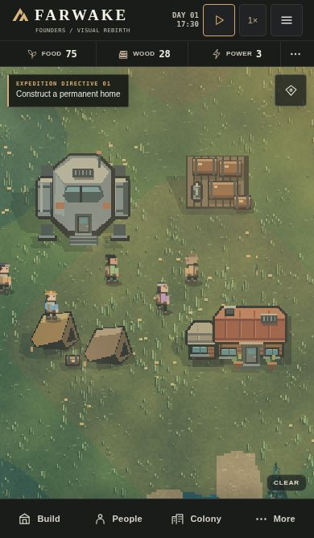

# Visual Rebirth release candidate

| Materials & Hauling 0.3.8 | Visual Rebirth |
| --- | --- |
|  |  |

The comparison uses FW-10402 at 17:30 with the same zoom, camera centre and completed home. See the [construction catalog](visual-rebirth/catalog.jpg) and [evening lights](visual-rebirth/dusk.jpg).

- Replaced the artwork for nine blueprints and three expedition structures. The catalog draws its illustrations from the in-world sprites.
- Added cached meadow, heath, fen, shoreline and rock textures, directional shadows, layered vegetation, animated water and weather, and warm evening lights.
- Added directional walking and work poses and distinct sprites for loose and carried materials.
- Reworked field controls, landscape navigation, contextual inspectors and construction cards. Warehouse inventory now compares stored, ground and carried material counts in one table.
- Corrected touch placement immediately after a viewport resize. The pointer handler now synchronizes the camera dimensions before interpreting the tap.
- Retained the version 3 save key, seeded tile generation, structure footprints, building costs and simulation rules.

## Verification

Tested the playable application in Chromium at 375×667, 390×844, 430×932 and 844×390 CSS pixels. Verified catalog and inventory layout at each size. After rotating, dispatched touch pointer events through the map to place a supply shed, advanced the game until construction completed, designated a tree, observed a timber pile, pickup and delivery, purchased grid storage and reloaded the expedition. The starting save was generated by the production baseline. Physical iPhone Safari, device frame times and thermal behaviour remain unmeasured.

To repeat, run `python tests/prepare-visual-check.py` and serve the printed temporary directory on a fresh local origin. Open `/check.html`. Test state is saved on that origin.
